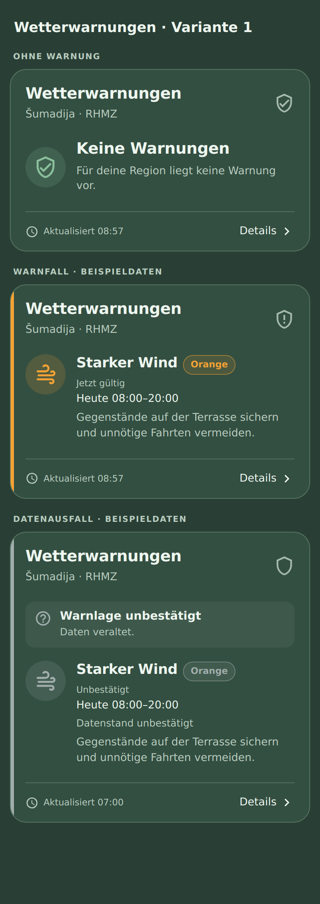

# Wetterwarnungen für Home Assistant

Kompakte Warnkarte nach **Variante 1**: übersichtlicher Status, grosse Symbole und ein kleiner Abrufzeitpunkt. Bei Warnungen erscheinen Warnstufe und Gültigkeitszeit direkt in der Karte. Vollständige Meldungen und Handlungsempfehlungen öffnest du mit **Details**.

Die Karte nutzt deine bereits vorhandene **CAP Alerts**-Integration (WMO/Meteoalarm). Sie ruft selbst keinen externen Wetterdienst ab und benötigt keinen API-Key, keine zusätzlichen Template-Sensoren, kein card-mod und keine Mushroom-Karten. Home Assistant ab 2026.10.



## Installation mit HACS

1. In **HACS → ⋮ → Benutzerdefinierte Repositories** dieses Repository eintragen:
   `https://github.com/AshenSage/ha-wetterwarnungen`
2. Als Typ **Dashboard** auswählen (bei älteren HACS-Versionen **Lovelace**), **nicht Integration**.
3. **Wetterwarnungen – kompakte CAP-Karte** herunterladen.
4. Dashboard bzw. Companion App vollständig neu laden.
5. Die bisherige Markdown-Karte durch diese Karte ersetzen:

```yaml
type: custom:wetterwarnungen-card
title: Wetterwarnungen
region: Šumadija
region_match: sumadija
provider_label: RHMZ
count_entity: sensor.cap_alerts_wmo_alert_count
updated_entity: sensor.cap_alerts_wmo_last_updated
time_zone: Europe/Belgrade
max_age_minutes: 30
max_visible: 2
grid_options:
  columns: 12
  rows: auto
```

Die Karte findest du auch im Kartenwähler unter **Wetterwarnungen**. Es gibt einen grafischen Konfigurationseditor.

Falls Home Assistant «Custom element doesn't exist» meldet, unter **Einstellungen → Dashboards → ⋮ → Ressourcen** prüfen, ob diese Ressource als **JavaScript-Modul** eingetragen ist:

```text
/hacsfiles/ha-wetterwarnungen/ha-wetterwarnungen.js
```

Danach die Seite mit geleertem Browsercache neu laden. Eine Meldung über eine fehlende `manifest.json` bedeutet, dass in HACS versehentlich **Integration** ausgewählt wurde: Das Repository entfernen und als **Dashboard** erneut hinzufügen.

## Verhalten

- **Keine Warnungen:** erscheint nur bei eindeutiger Datenquelle, gültigen Diagnosesensoren, aktuellem Abruf und vollständig geladenen Meldungen.
- **Gelb / Orange / Rot:** wetterbezogenes Symbol, Warnstufe und Zeitraum. Aktive Meldungen stehen vor angekündigten Meldungen, innerhalb der Gruppen die höchste Stufe zuerst.
- **Warnlage unbestätigt:** bei veralteten, fehlenden, unvollständigen oder nicht bestätigten Daten. Vorhandene Meldungen bleiben sichtbar. Eine getrennte Verbindung zu Home Assistant wird ebenfalls berücksichtigt.
- **Details:** alle Meldungen ohne gekürzte Texte, Handlungsempfehlungen, sämtliche zusammengehörigen Zeitfenster und Datenstatus. Bei Zuordnungsproblemen ist dort eine Diagnose aufklappbar.
- Zurückgezogene, abgelaufene und Testmeldungen werden ausgefiltert. Gleiche Meldungen werden zusammengefasst. Ein abgelaufener Zeitstempel wird auch ohne neue Sensordaten erkannt.

Die Farben und der Hintergrund passen sich deinem Home-Assistant-Theme an. Auf dem Handy werden lange Titel umgebrochen. Es gibt keine externe Schrift, Grafik- oder Skript-Abhängigkeit.

Die Erkennung und Sicherheitsprüfungen wurden aus der bisherigen Markdown-Karte für CAP Alerts 0.6.1 übernommen. CAP-Texte erscheinen in der Sprache der Quelle; die Karte erfindet oder übersetzt keine Warnmeldungen.

## Einstellungen

| Option | Standard | Bedeutung |
| --- | --- | --- |
| `title` | `Wetterwarnungen` | Kartentitel |
| `region` | `Šumadija` | Angezeigte Region |
| `region_match` | `sumadija` | Regionsname im CAP-Feld `area_desc`; für Šumadija werden auch `Šumadija` und `Шумадија` erkannt |
| `provider_label` | `RHMZ` | Angezeigter Quellenname |
| `count_entity` | `sensor.cap_alerts_wmo_alert_count` | Vorhandener Diagnose-Sensor mit Warnanzahl |
| `updated_entity` | `sensor.cap_alerts_wmo_last_updated` | Vorhandener Sensor für den letzten erfolgreichen Abruf |
| `device_id` | automatisch | Optional: vorhandene CAP-Geräte-ID bei mehreren Quellen |
| `max_age_minutes` | `30` | Nach dieser Zeit ist der Abruf veraltet |
| `time_zone` | `Europe/Belgrade` | Zeitzone für Datum und Uhrzeit |
| `max_visible` | `2` | Sichtbare Meldungen vor dem Aufklappen, 1–10 |

Die Gerätezuordnung wird aus deinen bestehenden Sensoren ermittelt. Anschliessend werden die vorhandenen Detail-Sensoren desselben CAP-Geräts gefunden. Gibt es keine eindeutige Zuordnung, erscheint keine pauschale Entwarnung.

## Manuelle Installation

`ha-wetterwarnungen.js` aus dem neuesten Release nach `/config/www/ha-wetterwarnungen.js` kopieren und `/local/ha-wetterwarnungen.js` als JavaScript-Modul unter den Dashboard-Ressourcen eintragen. Nur eine der beiden Installationsarten nutzen.

## Entwicklung

Keine npm-Abhängigkeiten für Build und Modelltests:

```sh
npm run check
```

Die Quellen liegen in `src/`; `npm run build` erzeugt die einzelne HACS-Datei im Repository-Hauptverzeichnis. Jinja läuft ausschliesslich über Home Assistants authentifizierte `render_template`-WebSocket-Subscription. Das Frontend prüft die Gültigkeitszeiten zusätzlich alle 30 Sekunden. Auf- und Abbau der Subscription folgen dem Lebenszyklus der Karte.

Die zusätzlichen Discovery-Tests lassen sich mit Python und Jinja2 ausführen:

```sh
python -m pip install jinja2
python test/template_test.py
```

Beim Push auf `main` werden Build und Tests geprüft. Ist die Version aus `package.json` noch nicht veröffentlicht, erstellt GitHub Actions ein **stabiles Release** mit der JS-Datei als Download. Für eine neue Version `package.json` und `RELEASE_NOTES.md` aktualisieren, `npm run build` ausführen und die generierte Datei mit committen.

Referenzen: [Home Assistant Custom Cards](https://developers.home-assistant.io/docs/frontend/custom-ui/custom-card/) · [HACS Dashboard-Repositories](https://www.hacs.xyz/docs/publish/plugin/)

MIT-Lizenz.
